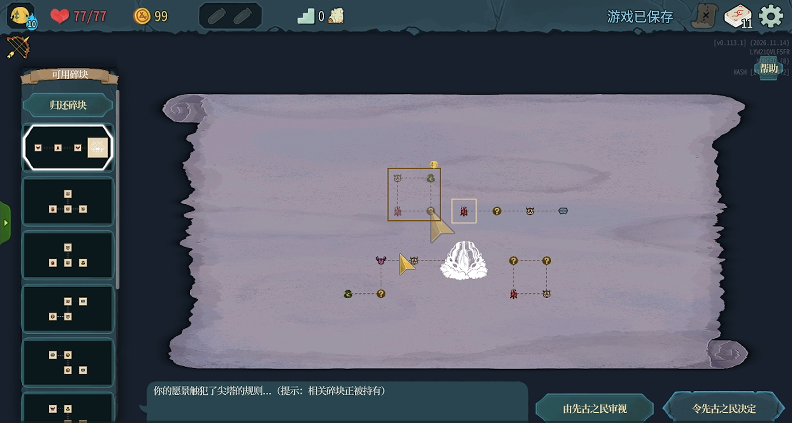
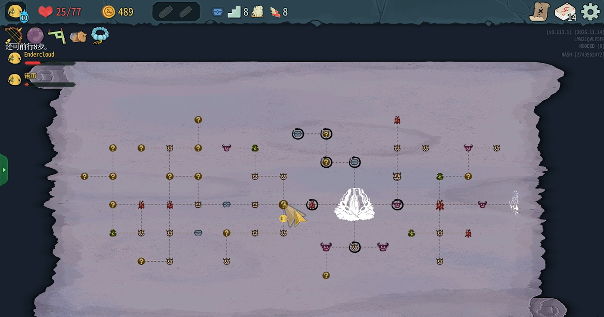
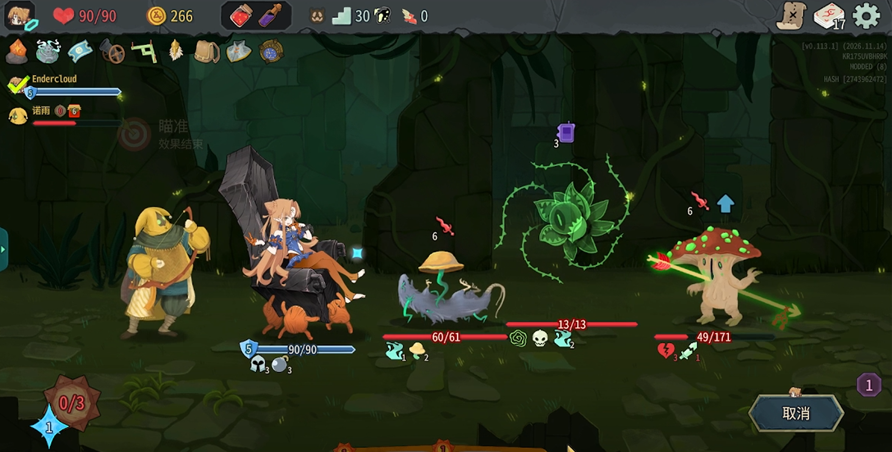
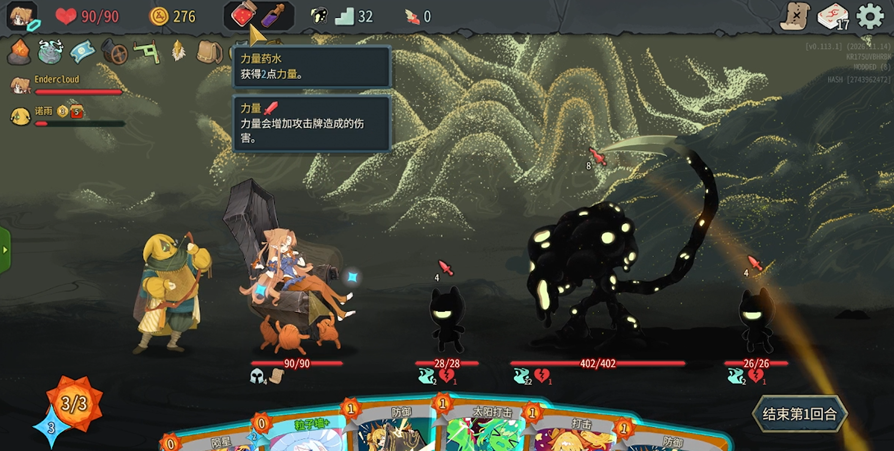
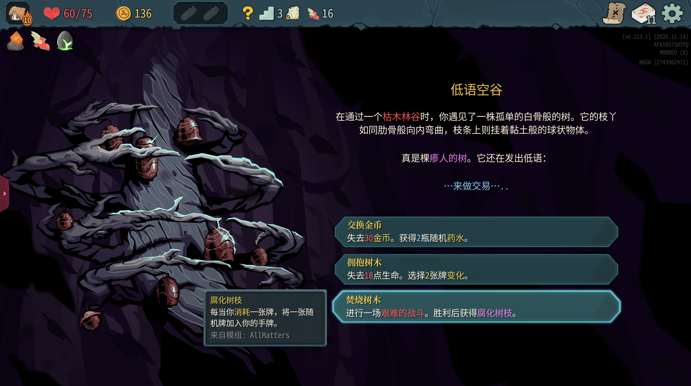
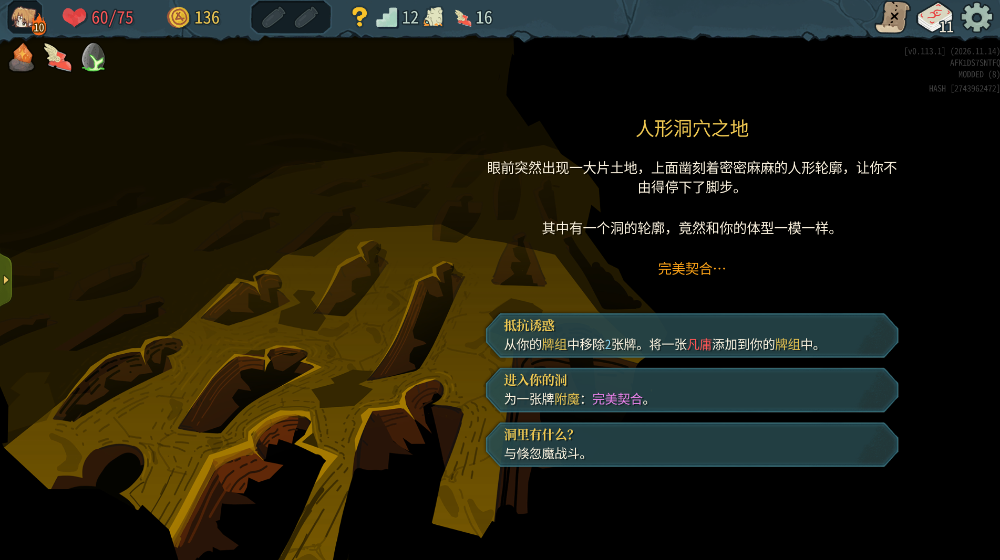
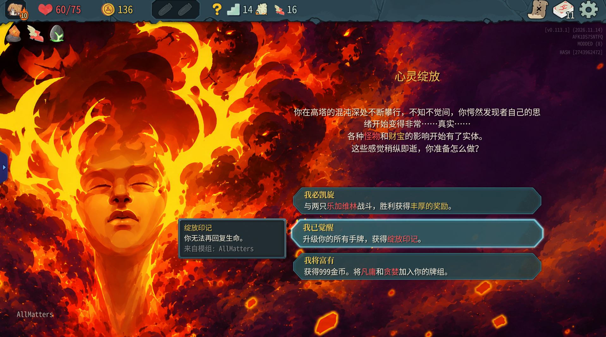
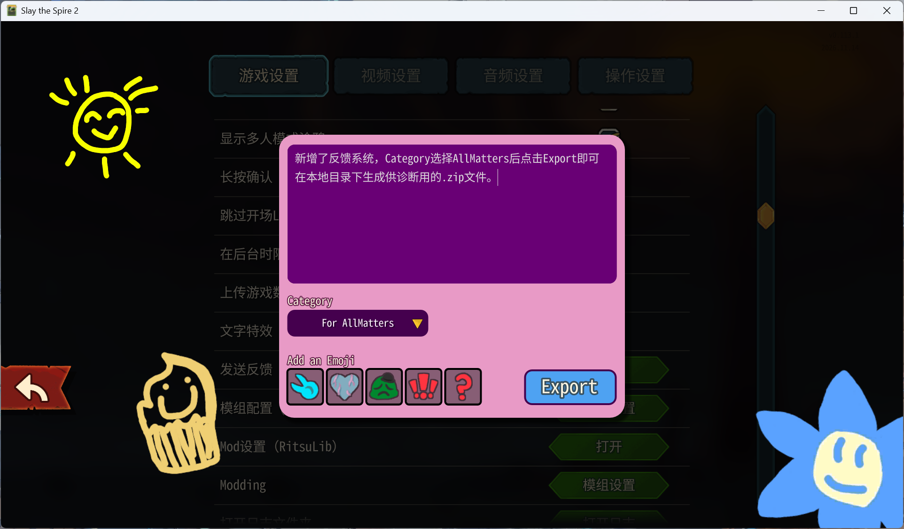

# AllMatters · 事无巨细

你好，欢迎来到AllMatters！

## v0.1.2 拼图更新

在 AllMatters 模组设置中默认会打开「局内启用拼图模式」。拼图适用于标准模式和 public-beta 的恐惧模式。

- **拼出自己的路线。** 每幕开始时可摆放、旋转并连接地图碎片，再选「由先古之民审视」。也可选「令先古之民决定」，让游戏生成地图。联机时可以一起编辑，全员同意后才开始检查地图或生成地图。



- **探索与续局。** 从已探索区域前往相邻的新房间，也可以沿已探索路线折返商店。



- **建筑师惩罚。** 每幕有有限的步数。耗尽后仍能探索，后续适用房间进入惩罚。密林、暗港、巢穴和荣耀均会改变怪物阵容、行动或首领机制。惩罚期间商店不允许交易，休息处仅能选择"休息"与"愈合"，普通宝箱必定为空。击败当幕Boss后移除建筑师面具。具体的改动见[此文档](docs/v0.1.2-battle-enhancement-in-hunting.md)。




## v0.1.1 事件、遗物与卡牌

为大部分二代事件新增或修改了交易、选牌、离开和战斗选项。具体的改动见[此文档](docs/event-in-STS2-change.md)。




回归了部分一代事件，但同样进行了部分修改。具体的改动见[此文档](docs/event-in-STS1-return.md)。



## 下载与安装

v0.1.2a 的适用版本为 **public 0.107.1** 和 **public-beta 0.113.1**，建议使用 [RitsuLib 0.6.11](https://github.com/BAKAOLC/STS2-RitsuLib/releases/download/v0.6.11/STS2-RitsuLib.0.6.11.variant-pack.zip)。联机玩家应使用相同的游戏分支与兼容模组组合。可以从 [发布页](https://github.com/Endercloud001/AllMatters/releases/) 下载与你的游戏版本对应的安装包。

| 游戏分支 | v0.1.2a 安装包（约 13.34 MiB） |
| --- | --- |
| public / 0.107.1 | [AllMatters-v0.1.2a-public.zip](https://github.com/Endercloud001/AllMatters/releases/download/v0.1.2a/AllMatters-v0.1.2a-public.zip) |
| public-beta / 0.113.1 | [AllMatters-v0.1.2a-public-beta.zip](https://github.com/Endercloud001/AllMatters/releases/download/v0.1.2a/AllMatters-v0.1.2a-public-beta.zip) |

1. 退出游戏，解压对应游戏分支的 AllMatters 安装包。
2. 在 Steam 的游戏「管理 → 浏览本地文件」打开安装目录。放入解压后的模组，确保清单位于 `mods/AllMatters/AllMatters.json`。
3. 把解压后的完整 RitsuLib 安装到 `mods/STS2-RitsuLib/`，保留原有目录结构及 `assets.zip`。
4. 启动游戏，在模组列表中启用 RitsuLib 与 AllMatters。

## 从源码构建

准备 .NET 9 SDK、Godot 4.5.1 mono、对应分支的游戏文件和完整 RitsuLib 包。首次配置时复制 `Paths.example.props` 为 `Paths.local.props`，再按开发指南填写本机路径。

```powershell
./tools/Build.ps1 -Branch public
./tools/Build.ps1 -Branch public-beta
```

构建输出位于 `dist/<branch>/AllMatters/`。运行 `./tools/Check.ps1 -Branch All` 可执行完整双版自动检查。

## 反馈入口

若有bug，请使用"游戏设置"中的"反馈功能"，在"Category"中选择"For AllMatters"，然后点击Export会在游戏目录下生成当局对局的必要信息压缩包。

当然，如果你有任何想告诉作者的建议或调整，均可以发送到 ender_cloud@163.com 。

作者很希望收到以下相关的反馈：

- 与其他mod联合使用时的bug（因为本身想主推玩法而不是仅限于修改数值/平衡性调整/一代内容回归，所以本作者鼓励玩家将本mod和其他mod一起使用）；
- 你的新玩法点子（最好是没有mod制作者做过的！）；
- 在开发层面上的建议（第一次做尖塔mod很多地方还不成熟还请包涵！）。
