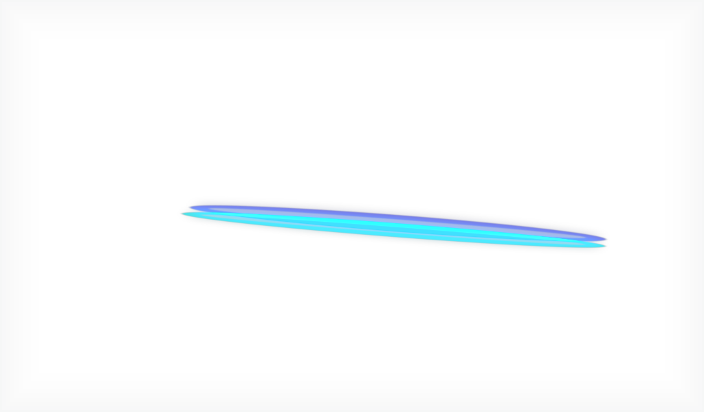

# #36 丛林迷宫双哨卫：开发与人工验证

## 开发过程

2026-10-27，依据 GitHub #36、父规格 #26、Q1–Q20 确认记录及已关闭前置 #35 实现。沿用原生 JungleMazeAdventure 共享选项及事件战斗入口，新增仅事件可用的双哨卫精英遭遇；保留原版另一选项。两只哨卫首意图相反，基础生命 38–42，生命走二代多人缩放，攻击每人 9 点、状态每人弃牌堆加入两张晕眩，两种行动交替，不增加进阶数值。

原生 ArtifactPower 在多人中自动增加层数，本票用仅作用于 Sentry 的缩放适配保留确认的开战恰好 1 人工制品。战斗使用 Elite 身份，保留原生精英奖励规则及其修改钩子，每位玩家另有独立 35–64 金币奖励；复用 #35 个人禁奖过滤。胜后返回指定叙述与蓝/红/金色、抖动效果。中文文档参考链接不作为游戏富文本显示。

完整 Spine 4.2.11 动画资源取自已核实的 Balance 转换集，改为本模组路径；来源和权属见根目录 THIRD_PARTY_NOTICES.md。无原生库或游戏程序集随包分发。

规范及需求两路代码审查发现并修正：事件遭遇误入普通精英池、游戏文案携带 Markdown URL、测试清理污染及素材声明缺项。全量验证还发现前置 Ambrosia 奖励测试遗留 RunManager 状态，已在保留原有断言的前提下补 finally 清理与本地玩家标识恢复。

## 自动化与边界

- `./tools/Test.ps1 -Branch All -Filter 'Jungle Maze'`：两目标各 3 项通过；覆盖事件转战斗/奖励/合法房间恢复、双哨卫实际伤害及晕眩、多人生命与人工制品、事件池过滤、双语颜色与 Spine 全动作加载。
- 最终完整检查：`./tools/Check.ps1` 通过，两目标各 148 项测试通过，两个开发包构建成功，输出 `AllMatters checks PASSED.`；结果见本机 `.local/jungle-check-final.log`。
- 目标 public 0.107.1、public-beta 0.111.0，依赖 RitsuLib 0.6.7 完整 variant-pack。public 使用已核对 DLL，并非完整 public 安装；资源宿主使用本机 beta PCK 与 Spine 库。
- 既有 Godot 宿主替代全局战斗状态、空手通知和房间入口；beta 验证第一位选择后未进入、第二位选择后只进入一次。public 的上层共享投票界面、正式 Mod 注册、真实房间调度、断线重连及回放需人工验证。合法房间恢复断言不等于完整实机中途存读档通过。
- 日志保留既有测试宿主程序集未关联正式 Mod 的诊断、资源缓存提示与既有可空引用警告，不宣称日志零错误；通过结论以退出码和行为断言为依据。
- 检查时仅临时规范原有 `docs/v0.1.1-scope.md` 的末尾空白，结束后按字节恢复；原有未提交规格/研究资料未纳入本票提交。

## 用户安装与验收步骤

开发包目录：

- public：`E:/Godot_v4.5.1-stable_mono_win64/sts2mod/AllMatters/dist/public/AllMatters/`
- public-beta：`E:/Godot_v4.5.1-stable_mono_win64/sts2mod/AllMatters/dist/public-beta/AllMatters/`
- 独立依赖：`E:/Godot_v4.5.1-stable_mono_win64/sts2mod/AllMatters/.local/dependencies/RitsuLib-0.6.7/`

退出游戏并备份现有 Mod，按当前游戏分支将对应开发包放入 `mods/AllMatters/`；依赖使用完整 variant-pack 放入 `mods/STS2-RitsuLib/`，不能只取 compat DLL。由用户通过 Steam 启动并核对加载日志。Agent 未启动游戏/Steam，未向游戏安装目录部署。

1. 单人进入丛林迷宫，检查“结伴而行”说明与红色“战斗”，另一选项仍按原版工作；选择结伴后出现两只完整动画哨卫，各 38–42 基础生命及 1 人工制品，首意图相反。
2. 多人分别选择：尚有人未同意时保持事件，全部同意后仅进入同一场战斗。检查生命随人数按原生规则缩放；每只哨卫仍恰好 1 人工制品。观察激光、充能、受击、待机动作与意图对齐。
3. 不带增伤/减伤效果，检查每只激光对全部存活玩家各造成 9 伤，另一行动给每人弃牌堆各 2 晕眩；下一次交换行动。高进阶复验固定数值。
4. 胜利后每名合格玩家各有正常精英奖励（含原版随机与遗物修改）及一份额外 35–64 金币；某玩家喝仙馔后仅该玩家无战利品，队友正常，下场恢复。检查奖励页/合法恢复不重复发放。
5. 返回事件核对完整新叙述：乌贼巫师阿奎德蓝色、格拉索里安战士红色、构装体守卫金色、美好的回忆抖动；切换英文复验对应展示。
6. 在后续石中剑、昆虫标本工单可用时复用本场景验精英身份与两单位计数；本票自动化只证明原生 Elite 身份，未宣称尚未完成的消费者行为通过。
7. 两分支分别记录版本、截图/日志与结果；另做真实联机、允许时点的存读档及回放，观察投票、意图、掉落与个人禁奖是否一致。普通地图遭遇不应随机出现此双哨卫事件战斗。
## 实机反馈修正：哨卫动画与敌方回合中断（2026-10-27）

用户实机反馈两只哨卫动作不正确，敌方行动后无法进入下一回合。读取本机 `SlayTheSpire2/logs/godot.log`，1094–1095 行显示分别执行 BOLT、BEAM；1096 行起缺少 `res://scenes/vfx/vfx_attack_pierce.tscn`，1214 行明确报告敌方回合循环因 `VfxCmd.PlayVfx` 空引用中断。另发现手动传入 `attack`，而动画器注册的是 `Attack`；原生 FromMonster 已自动触发 Attack，手动调用既无效又重复。

修正为通过原生攻击命令统一触发 `Attack` 并等待 0.25 秒，命中效果改为已核实可加载的原生 `vfx_attack_slash`。生命、人工制品、伤害、晕眩、目标、奖励及首意图规则保持确认玩法。

此前只验证 Spine 中有动作，未验证真实动作调用选择的触发名与命中特效，无法发现此故障。新增 `Jungle Maze move commands` 回归用例：观察真实招式的动画命令，将其送入真实 Spine 动画器，断言触发已注册、启动对应动作、完成后返回 idle；加载实际攻击命令选择的 PackedScene。行为测试扩展为连续两轮，逐次检查每位玩家受到 9 伤/新增两张晕眩与交替状态。

修复前 `./tools/Test.ps1 -Filter 'Jungle Maze move commands'` 稳定失败，报告未注册 `attack` 和缺失 `vfx_attack_pierce`（`.local/sentry-visual-red.log`）。修复后 `./tools/Test.ps1 -Branch All -Filter 'Jungle Maze'` 两目标各 4 项通过（`.local/sentry-visual-green.log`）。测试宿主没有完整 NCreature 房间节点，视觉命令通过探针桥接，命中特效验证资源加载而非完整实机渲染；不把该结果表述为实机已复验。

人工复验：用户更新对应分支开发包后重新进入该事件战斗（已中断的房间需要退出重进，替换文件不会恢复已终止的回合任务）；结束玩家回合，确认一只播放充能并加两张晕眩，另一只播放攻击并造成 9 伤，之后玩家回合正常开始；连续观察下一轮两只交换行动、动作结束回待机。再完成战斗确认奖励和战后叙述。Agent 未启动游戏或 Steam，也未安装新包。

最终完整检查 `./tools/Check.ps1` 通过：public 与 public-beta 各 149 项测试通过，双目标开发包构建成功（`.local/sentry-bug-check.log`）；规范与需求两路复审均无剩余问题。

## 实机反馈：补入一代激光和音效（2026-10-27）

用户确认修正后已能正常战斗，并提供战利品截图；这不是所有奖励、真实多人或存读档的逐项验收。随后用户观察到攻击没有激光，批准参考一代加入 SmallLaserEffect 及音效。

核查发现一代光束是独立二维效果，不包含在 Spine attack 动作中。依据本机正版一代 jar 的行为和图集条目，自行实现 Godot 青/蓝双层加色光束，半秒生命周期、二次淡入和 bounceIn 淡出、副层宽度和长度抖动，并附短暂天蓝边框闪光。边框使用 Godot 多层描边近似，不宣称与一代逐像素一致。仅裁剪 laserThin 区域并导出原短光束音频；完整来源见研究记录和 THIRD_PARTY_NOTICES.md。

攻击通过 BeforeDamage 生成一次覆盖所有存活玩家的光束及一次音效，普通等待 0.3 秒、快速等待 0.1 秒；去掉上一修复暂用的划痕命中特效。一代 SFXAction 的 0.5 表示音高随机幅度，对应 0.5–1.5 倍音高。RitsuLib 虚拟事件在播放时采样 SFX 总线，并显式乘主音量设置值的平方（与原生曲线一致），因为文件播放不进入 FMOD Studio 图；半秒级播放不追踪开始后的设置变化。伤害与玩法仍由原生命令结算，视觉不依赖完成信号；没有房间、角色视觉或存活目标时跳过光束，不阻断结算。视觉随机使用 Godot RNG，不消耗跑局 RNG。

自动化新增实际攻击回调的光束/音效计数、单/双人端点数量、原始纹理与 Ogg 解码、变换容器下的端点几何、加色材质继承、淡入峰值、半秒释放及容器提前退出清理；主音量 0/0.5/1 与 SFX 总线路由也有断言。沿用连续两轮伤害、晕眩、动作回 idle 及事件奖励测试。宿主仅替换缺失的房间坐标查找，以人工端点执行真实创建/音效注册路径；拦截实际发声，因而不能证明真实音频设备播放、FMOD 总线最终听感或战斗实际坐标。资源加载与无界面测试不等于实机外观验收。

人工复验（两分支分别执行，安装方式及依赖目录同上）：

1. 用户更新对应开发包后进入新双哨卫战斗，结束回合；攻击哨卫播放 attack，从核心到玩家中心出现青蓝短激光、轻微边框闪光并响起一次短光束声。充能行动仍播放另一动作并加入两张晕眩，不额外发射激光。
2. 连续两轮确认两只交换行动，每次攻击仍按确认规则各 9 伤，动作结束回待机、玩家回合正常开始。切换快速模式确认时机正常、没有残留光束。
3. 双人时确认同一攻击分别连接每位存活玩家且只响一次；玩家死亡/离场及结束战斗时无孤立特效。调整窗口大小观察端点和边框位置。
4. 分别将主音量或音效音量归零，确认无激光声；恢复音量后声音恢复，0.5 音量组合无异常放大。激光播放中退出战斗/返回地图，无持续声音或节点。
5. 完成战斗复验战利品和事件结尾，记录游戏版本、模式、截图及日志。Agent 未启动游戏/Steam、未安装产物。

最终验证：`./tools/Check.ps1` 退出码 0，public 0.107.1 与 public-beta 0.111.0 各 150 项测试通过，两个开发包均生成，日志 `.local/laser-check-final.log`。专项两目标各 5 项通过，日志 `.local/laser-tests.log`。保留既有宿主诊断及可空引用警告；临时规范无关 scope 文件末尾后已按原字节恢复。

规范审查：发现虚拟音效主音量未继承及平方曲线缺失，已修复并补静音/比例断言，复审无剩余问题。需求审查：无剩余问题，确认图集 packed crop 合理、全体目标与原生结算保留；真实端点和音频听感明确留给人工复验。审查范围为 `eed7d37` 后本轮激光改动；先前 #36 实现与回合修复的审查见上述记录。

## 再次实机反馈：激光始终透明的运行时修复（2026-10-27）

用户再次反馈攻击没有可见激光。只读核对发现已安装 DLL/PCK 的长度与修改时间和上一轮开发包一致，游戏日志记录了 BEAM，未见激光资源缺失；不能把问题归因于用户未更新。新增测试将效果加入真实 SceneTree，等待 0.15 秒而不调用任何更新方法，修复前断言失败，见 `.local/laser-recheck-red.log`。

根因：AllMatters.csproj 使用 Microsoft.NET.Sdk，未接入 Godot 脚本源生成器；此前自定义 SmallLaserEffect : Node2D 的 `_Process`、`_Draw` override 没有生成原生调用桥接。效果创建时 alpha=0，实际运行中一直为 0。旧测试手动调用 `_Process` 后才检查透明度与释放，绕过了真实故障。因此上一轮测试通过不能证明游戏内可见，此前完成结论过早。

修复沿用仓库 WheelSpinPresentation 的原生节点模式：SmallLaserEffect 改为静态工厂，创建原生 Node2D；TreeEntered 信号创建绑定该节点的 Tween，通过委托更新透明度和双层抖动，通过 Draw 信号绘制边框，半秒后自动释放。父容器释放同时终止 Tween；未改变攻击规则、音效或原生伤害结算。无需新增 Godot SDK、脚本注册或构建依赖。

回归测试移除手动 `_Process` 调用，改为自然 SceneTree 时间验证出现、峰值和释放，保留几何、材质、资源、音频参数及提前离场清理断言。修复后 public/public-beta 各 5 项激光相关测试通过，见 `.local/laser-recheck-green.log`。另在独立 Godot 测试宿主使用 OpenGL Compatibility 渲染 SubViewport，并从内部区域检测可见青蓝像素；第一次绘制预热后通过，检测到 8,183 个可见像素，见 `.local/laser-render.log`。截图为测试坐标和透明背景，不是实机战斗截图，也不证明真实战斗坐标或音效听感。

人工验证沿用上一节步骤：完整退出游戏，替换对应分支的新 DLL 和 PCK 后重新启动，进入新战斗观察 BEAM 激光、连续两轮行动及伤害；勿只替换 PCK 或在进程运行时替换 DLL。此次 Agent 仍未启动游戏/Steam，未改动游戏 mods 安装。

最终完整检查 `./tools/Check.ps1` 退出码 0：public 0.107.1 与 public-beta 0.111.0 各 150 项测试通过，两个开发包重新生成，见 `.local/laser-callback-check.log`。public 独立渲染复验也通过，见 `.local/laser-render-public.log`；规范与需求两路审查均无剩余问题。本轮审查起点 `6b7d2ec`。已有无关 scope 末尾空白仅检查期间临时规范，随后按原字节恢复。
