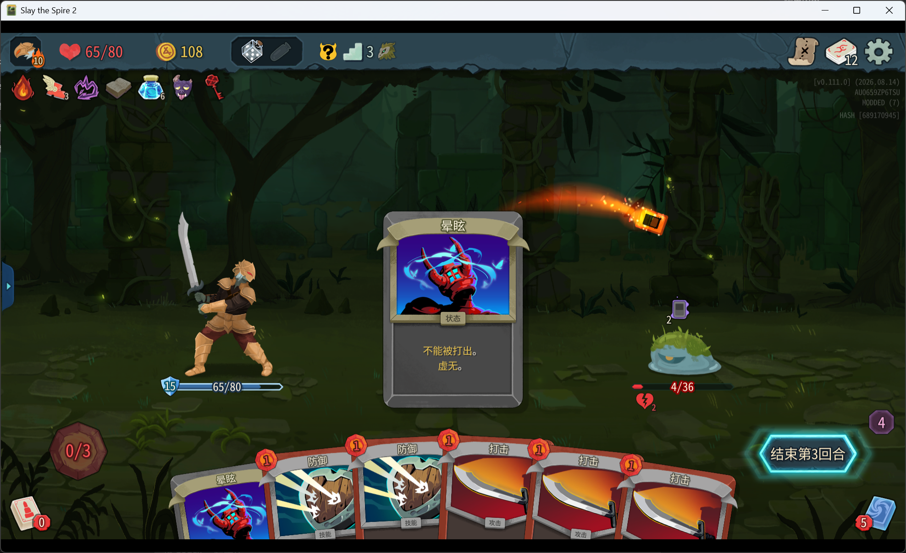
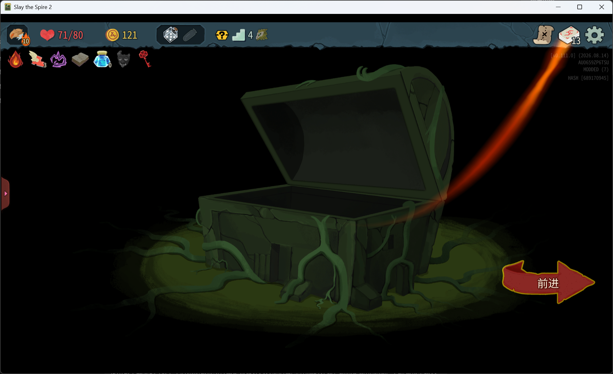

# v0.1.1 组合验收与交付

日期：2026-10-28。依据：[父规格 #26](https://github.com/Endercloud001/AllMatters/issues/26)、[组合验收 #48](https://github.com/Endercloud001/AllMatters/issues/48)。实现起点为 `01887930fb9bc3db3953e177954ed15a7c4178e4`（main）；#27–#47 功能票已关闭。用户原有范围原件、未跟踪的规格/调研/工单草稿及 sentry.png 不属于本次修改。

本次用户反馈补齐此前指出的两项组合证据后，#48、#26 已以 `completed` 关闭；GitHub 正文追加了自包含验收摘要和未验证边界。本次计数显示追加代码及本记录尚未提交／推送。

## 内容与证据映射

E 编号取自 GitHub #26 的完整内容附录；下表覆盖全部 45 项，同一事件的多个切片可共用编号。

| 规格事件 | 实施工单 | 验证记录 |
| --- | --- | --- |
| E07、E15、E17、E24–E26、E28、E31、E34–E35、E38–E39、E44–E45 | #27 | [原生事件批次](native-events-27-35.md) |
| E01–E03、E06、E19 | #28 | 同上 |
| E23、E04、E05 | #29、#30、#31 | 同上 |
| E11、E13、E20、E33、E36–E37、E40 | #32 | 同上 |
| E12、E14、E29–E30 | #33 | 同上 |
| E08、E22、E27、E41 | #34 | 同上 |
| E16 | #35 | 同上 |
| E10 | #36 | [双哨卫](jungle-maze.md) |
| E11 战斗部分 | #37 | [低语空谷](whispering-hollow.md) |
| E18 | #38 | [茂密植被](dense-vegetation.md) |
| E09、E21 | #39–#44 | [垃圾堆](trash-heap.md)、[卡牌与遗物](events-40-44.md) |
| E32、E42、E43 | #45、#46、#47 | [倏忽魔、第一勇士与法官](events-45-47.md) |

19 张卡牌：光辉、结茧、自动护盾、核心电涌、瞄准靶心、电动力学、缴械、飞踢、幽灵铠甲、收割、无尽苦痛、恐怖、他山之石、斋戒、阿尔法、贝塔、欧米伽、以手拒之、通晓万物。实现及行为覆盖分别见 `NativeRadianceTests`、`NativeSelectionTests`、`TrashHeapDefectTests`、`TrashHeapRedGreenTests`、`TrashHeapColorlessTests`、`OmniscienceTests`。

16 件关联遗物：蓝蜡烛、诅咒钥匙、共生病毒、奇怪蘑菇、带骨肉、毒巫娃娃、墨水瓶、恩洛斯的礼物、恩洛斯的饥饿的脸、御守、昆虫标本、机械臂、结实绷带、卡戎之灰、腐化树枝、冠军腰带。部分复用并修改原生模型，不以新增类文件数量计数。另交付仙馔密酒，以及双哨卫、扭曲团块、倏忽魔、第一勇士、原生法官五类战斗。

10 项保持原行为的事件：无尽传送带、深渊浴场、药水快递员、长者兰伟德、商人？？？、永恒之石、巨大花卉、战痕累累的训练假人、打造时间、遗忘之墓。未为这些事件引入 Balance 的选项改动；全局卡牌/遗物改动仍按父规格生效。原有兰伟德、永恒之石药水冻结保持原生措施。

## 组合验收

| 组合 | 已有证据与结果 |
| --- | --- |
| 个人禁奖＋保证战利品 | `WhisperingHollowTests` 验证禁止饮用者取得腐化树枝等战利品，队友奖励、孢子清理保留；`TeaTrialTests` 验证冠军腰带也受个人禁奖限制。 |
| 面具＋诅咒钥匙宝箱 | 用户本次同时持有两件遗物开箱，取得一张诅咒、未获遗物，明确确认符合预期。 |
| 御守＋诅咒 | `TrashHeapRelicTests` 通过真实永久牌组入堆验证两次抵消、用尽和保存恢复。 |
| 蓝蜡烛＋通晓 | `OmniscienceTests` 实际自动打出原本不可打的诅咒两次，失去 4 生命并消耗。 |
| 事件精英＋计数／缩小 | `TrashHeapRelicTests` 用双哨卫验证精英单位计数、去人工制品、缩小与实际伤害；普通怪物和 Boss 不误缩小。 |
| 自动出牌＋病毒／墨水瓶／历史课 | 用户使用铁甲战士「倾泻」实测，确认自动打出计入病毒、墨水瓶，历史课也正常生效。 |
| 自动／重复出牌＋紧握 | `TeaTrialTests` 验证第 3/6/9 玩家阶段额外扣出牌者能量，重复免费打出仍触发，法官死亡即停。 |

用户提供的两张截图显示 public-beta v0.111.0；该版本标记及用户反馈仅支持本次场景，不扩写为 public 完整环境、真实联机或回放逐项通过。

## 本次追加：共生病毒计数显示

按用户要求沿用墨水瓶的遗物栏计数方式。显示已实际打出的非攻击牌余数 0–4，第 5 张生成晕眩时归零；使用已有保存值，跨回合、跨战斗和读档保持一致。通过原生 `DisplayAmountChanged` 通知刷新；攻击牌不增加计数，其他遗物继续使用原有显示。

强化现有 `NativeCounterTests.Virus`，验证初始显示、逐张刷新、攻击不计数、保存恢复后显示余数及下一场第五张归零，同时保留实际抽牌和生成一张晕眩的断言。双目标计数专项各 7 项通过，日志 `.local/virus-counter-focused.log`。新增数字在完整游戏里的视觉由用户安装新包后观察；本次用户截图发生在此追加改动之前。

随后完整执行 `./tools/Check.ps1`：public 0.107.1 与 public-beta 0.111.0 各 **216 项通过**，PowerShell 语法、脚本流程、资源导入／导出和双目标开发包构建均通过。日志 `.local/virus-counter-check.log`（beta 汇总第 4696 行、public 第 5730 行、步骤汇总第 5761 行起）。命令最终退出码 **1**，唯一失败为用户原有 `docs/v0.1.1-scope.md:781` 的 EOF 空行；保留该文件，未为全绿修改原件。本次三份 C# 文件的 `git diff --check -- <本次路径>` 通过。

独立审查者只读复核上述三份 C# 相对开工提交的差异，未发现实际问题；确认 getter 只影响原生病毒、刷新顺序与墨水瓶一致、显示复用原保存状态。审查未运行第二组测试，亦未将模型通知检查当作完整 Godot 角标渲染验收。

## 安装及后续验证边界

开发目标为 public 0.107.1、public-beta 0.111.0，不宣称是最新发行版。自动化继续使用真实目标 DLL、既有 Godot 宿主和本机 beta 资源包／Spine 库；不等同完整 public 游戏环境。你好世界与 11 个 v0.1 事件继续包含在现有完整回归入口。

开发包分别位于 `dist/public/AllMatters/`、`dist/public-beta/AllMatters/`，包含 DLL、PCK、manifest、LICENSE 和 THIRD_PARTY_NOTICES。独立依赖为完整 RitsuLib 0.6.7 variant-pack（本机 `.local/dependencies/RitsuLib-0.6.7/`；来源见 [依赖记录](../references.md)），需保留 compat、shared、assets.zip 等完整内容。

由用户退出游戏并备份现有 Mod 后，将匹配版本的完整开发包更新至 `mods/AllMatters/`，完整依赖包更新至 `mods/STS2-RitsuLib/`，再经 Steam 启动。此次 Agent 未启动游戏／Steam，未写入游戏 mods 或正式发布。

人工检查病毒栏初始数字、倾泻自动打出中的增量、第 5 张归零和下场保留；历史玩法组合的预期见上表。后续真实两人联机需检查主客机出牌、奖励及计数归属；在游戏允许的保存点退出恢复，核对选项 RNG、费用和奖励不重复，再检查上述过程回放。记录实际版本、语言、人数及截图／日志；这些尚未逐项执行的完整 public、网络、恢复和回放验证保持待验证，不作为已经通过的证据。
